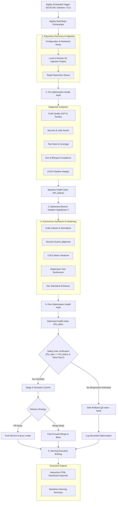

<div align="center">

# 🌙 GitHub Nightly Autonomous Optimizer & Continuous Dev Engine
### Autonomous Overnight Multi-Repository Diagnostics, Testing & Quality Synthesis

[](https://python.org)
[](LICENSE)
[]()
[]()
[](#راهنمای-فارسی-و-مستندات-معماری-سیستم)

<p align="center">
  <b>A production-grade, unattended overnight autonomous agent for software repositories.</b><br>
  Audits multi-dimensional health metrics, eliminates technical debt, synthesizes regression tests, hardens CI/CD pipelines, and securely raises verified Pull Requests while you sleep.
</p>

[Key Features](#key-features) •
[Architecture](#system-architecture) •
[Mathematical Formulation](#mathematical-formulation) •
[Quick Start](#quick-start) •
[CLI Reference](#cli-reference) •
[Persian Docs / راهنمای فارسی](#راهنمای-فارسی-و-مستندات-معماری-سیستم)

</div>

---

## 🌟 Key Features

- **Multi-Dimensional Diagnostic Engine:** Audits code quality (AST parsing, syntax, imports), security (high-entropy credential and leak detection), test robustness, documentation consistency, and CI/CD coverage.
- **Safety Gate & Zero-Regression Invariant:** Enforces strict rollback mechanisms; changes are instantly aborted and reverted if tests fail or if the repository health score degrades.
- **Autonomous Branching & Safe Delivery:** Operates on isolated ephemeral branches (`nightly/opt-YYYYMMDD-*`), executing verification suites before creating structured GitHub Pull Requests via `gh pr create`.
- **Automated Synthesis Modules:**
  - *Code Cleaner:* Eliminates whitespace anomalies, normalizes UTF-8 encodings and EOF endings.
  - *Security Guard:* Generates hardened `.gitignore` boundary filters preventing secret leaks.
  - *CI/CD Hardener:* Deploys multi-platform GitHub Actions workflows (Python, Rust, Go, C++).
  - *Test Synthesizer:* Generates automated pytest regression and integrity suites for uncovered modules.
  - *Bilingual Documentation Enhancer:* Consolidates documentation and ensures compliance with project standards.
- **Executive Morning Dashboard:** Produces interactive, zero-bloat HTML & Markdown digests summarizing repo health deltas, applied optimizations, and active PRs.
- **Native OS Scheduling:** Integrates with Windows Task Scheduler (`schtasks.exe`) and provides a standalone in-process background daemon.

---

## 🏗️ System Architecture



---

## 📐 Mathematical Formulation

The unified **Repository Health Index** ($\Phi$) evaluates a software repository across five orthogonal dimensions:

$$\Phi = \sum_{i=1}^{5} w_i \cdot S_i \quad \text{such that} \quad \sum_{i=1}^{5} w_i = 1.0, \quad S_i \in [0, 100]$$

| Index $i$ | Evaluation Dimension | Assigned Weight $w_i$ | Primary Evaluation Metrics |
| :---: | :--- | :---: | :--- |
| **1** | **Code Quality & Architecture ($S_{\text{cq}}$)** | $0.25$ | Syntax validity, AST parse integrity, import hygiene, cyclomatic complexity |
| **2** | **Test Robustness & Verification ($S_{\text{tst}}$)** | $0.25$ | Test-to-source file ratio, automated test suite pass rate, mock coverage |
| **3** | **Security & Secret Hygiene ($S_{\text{sec}}$)** | $0.20$ | Zero leaked API keys/tokens, entropy scan, `.gitignore` boundary completeness |
| **4** | **Documentation & Compliance ($S_{\text{doc}}$)** | $0.15$ | Badges, architecture diagrams, LaTeX math, consolidated bilingual sections |
| **5** | **CI/CD Automation ($S_{\text{ci}}$)** | $0.15$ | GitHub Actions presence, multi-OS matrix builds, push/PR event triggers |

### Safety Transition Condition:
An automated transition from state $t$ to $t+1$ is committed **if and only if**:

$$\Delta \Phi = \Phi_{t+1} - \Phi_t \ge 0 \quad \wedge \quad \mathcal{E}_{\text{syntax}}(t+1) \le \mathcal{E}_{\text{syntax}}(t) \quad \wedge \quad \mathcal{T}_{\text{fail}}(t+1) = 0$$

Where $\mathcal{E}_{\text{syntax}}$ represents the syntax error count, and $\mathcal{T}_{\text{fail}}$ denotes unit test suite execution failures.

---

## 🚀 Quick Start

### 1. Prerequisites
- Python 3.11+
- Git 2.40+
- GitHub CLI (`gh`) authenticated with repository permissions:
  ```bash
  gh auth status
  ```

### 2. Configuration
Inspect or customize `nightly_config.json` (or `config/default_config.json`):
```json
{
  "github_user": "ArdavanGhal-Eh",
  "monitored_directories": [
    "C:\\Users\\ardav\\OneDrive\\Desktop\\پروژه_های گیت_هاب (Portfolio Projects) - اردوان قلعه",
    "C:\\Users\\ardav\\Desktop\\face_finder"
  ],
  "target_repos": ["*"],
  "delivery_strategy": "pr",
  "nightly_schedule": {
    "enabled": true,
    "time": "02:00",
    "task_name": "GitHubNightlyOptimizer"
  }
}
```

### 3. Immediate Audit Diagnostic (Non-Destructive)
```bash
python main.py audit
```

### 4. Dry-Run Simulation
Simulate the full overnight cycle across all repositories without making filesystem changes:
```bash
python main.py run --dry-run
```

### 5. Execute Overnight Optimization Cycle
```bash
python main.py run
```

---

## 🛠️ CLI Reference

```
usage: nightly [-h] {run,audit,list,schedule,daemon,report} ...

Subcommands:
  run        Execute nightly optimization cycle
             Options:
               --dry-run        Simulate cycle without modifying files
               --repo <name>    Target single repository by name
               --strategy <spr> Override delivery (pr, direct_merge, branch_only)
  audit      Run non-destructive diagnostics on repositories
             Options:
               --repo <name>    Target single repository by name
  list       List all discovered local and remote repositories
  schedule   Manage native Windows Task Scheduler integration
             Options:
               --action {register,status,delete}
               --time HH:MM     Daily trigger time (default: 02:00)
  daemon     Run persistent in-process background timer daemon
             Options:
               --hour <0-23>    Execution hour
               --minute <0-59>  Execution minute
  report     Inspect or open latest morning dashboard
             Options:
               --open           Launch latest HTML dashboard in default browser
```

---

<a id="راهنمای-فارسی-و-مستندات-معماری-سیستم"></a>
# راهنمای فارسی و مستندات معماری سیستم

## ۱. معرفی سیستم
**سیستم هوشمند بهینه‌سازی و توسعه شبانه پروژه‌های گیت‌هاب (GitHub Nightly Autonomous Optimizer)**، یک فریم‌ورک کاملاً خودکار و عملیاتی برای مهندسی مداوم نرم‌افزار است. این سیستم به منظور ممیزی جامع، پاک‌سازی کدهای منسوخ، تزریق الگوهای تست خودکار، ارتقای خطوط CI/CD و بازتولید ساختارهای مستندسازی استاندارد در زمان خواب توسعه‌دهنده (پنجره زمانی شبانه) طراحی شده است.

## ۲. ارکان پنج‌گانه ممیزی و شاخص سلامت مخازن
سیستم سلامت هر مخزن را در قالب شاخص یکپارچه $\Phi \in [0, 100]$ بر اساس پنج مؤلفه ارزیابی می‌کند:

1. **کیفیت کد و معماری (Code Quality - ضریب ۲۵٪):**
   - تحلیل ساختار نحوی با استفاده از AST Parser در پایتون، ردیابی خطاهای گرامری، رفع Importهای غیرضروری یا Wildcard (`from x import *`) و ارزیابی پیچیدگی محاسباتی.
   - اعتبارسنجی مانیفست‌های پروژه‌های چندزبانه (مانند `Cargo.toml` برای Rust، `go.mod` برای Go و `CMakeLists.txt` برای C++).

2. **پایداری تست و تأیید عملکرد (Test Robustness - ضریب ۲۵٪):**
   - محاسبه نسبت فایل‌های تست به کدهای عملیاتی.
   - اجرای آزمون‌های Pytest در محیط ایزوله و سنتز آزمون‌های رگرسیون جدید برای ماژول‌های فاقد پوشش تست.

3. **امنیت و عدم افشای کلیدها (Security Hygiene - ضریب ۲۰٪):**
   - اسکن کلیه فایل‌ها با عبارات منظم انتروپی بالا جهت کشف توکن‌های تصادفی (GitHub Tokens, OpenAI API Keys, AWS Keys, Telegram Bot Tokens).
   - اعتبارسنجی و تقویت فایل `.gitignore` جهت ممانعت از ارسال فایل‌های کش (`__pycache__`)، فایل‌های محلی (`.env`) و باینری‌ها.

4. **مستندسازی و استانداردهای دوزبانه (Documentation - ضریب ۱۵٪):**
   - تطابق با قاعده **RULE-004**: تجمیع یکپارچه مستندات انگلیسی و فارسی در فایل واحد `README.md` با جامپ‌های داخلی (`#...`) و جلوگیری از ایجاد فایل‌های جداگانه نظیر `README_FA.md`.
   - حضور نشان‌های وضعیت (Shields.io)، نمودارهای جریان و معماری Mermaid، فرمول‌های ریاضیاتی فرمت LaTeX و مجوز معتبر متن‌باز (`LICENSE`).

5. **اتوماسیون CI/CD و گیت‌هاب اکشنز (CI/CD - ضریب ۱۵٪):**
   - تضمین وجود پایپ‌لاین‌های چندسکویی (Ubuntu و Windows Matrix) جهت بیلد و اجرای خودکار تست‌ها در رخدادهای `push` و `pull_request`.

## ۳. دروازه ایمنی و تضمین عدم رگرسیون (Safety Gate)
سیستم هیچ‌گاه تغییرات شکست‌خورده یا نزول‌دهنده کیفیت را ثبت نمی‌کند:
- تغییرات ابتدا در یک شاخه ایزوله و موقت به نام `nightly/opt-YYYYMMDD-*` اعمال می‌شوند.
- پس از اعمال ارتقاها، ممیزی مجدد انجام می‌شود. اگر شاخص سلامت کاهش یابد، خطای سینتکسی ایجاد شود یا تست‌های واحد رد شوند، سیستم بلافاصله دستور `git reset --hard` را اجرا کرده و شاخه را بدون دستکاری وضعیت اصلی پروژه، پاک‌سازی می‌کند.
- در صورت تأیید سلامت، شاخه به گیت‌هاب ارسال شده و یک **Pull Request مستند همراه با جدول مقایسه قبل و بعد** با دستور `gh pr create` ایجاد می‌شود تا صبح توسط شما بررسی و ادغام گردد.

## ۴. زمان‌بندی بومی و گزارش صبحگاهی
- **Windows Task Scheduler:** با اجرای دستور `python main.py schedule --action register --time 02:00`، یک وظیفه سیستمی در ویندوز ثبت می‌شود که هر شب رأس ساعت ۰۲:۰۰ بامداد به طور خودکار اجرا می‌گردد.
- **داشبورد بامدادی (Executive HTML Dashboard):** پس از هر چرخه شبانه، یک داشبورد مدرن، شیک و تعاملی در مسیر `reports/latest_dashboard.html` تولید می‌شود که کارت‌های شاخص کلیدی (KPI)، جدول فیلترپذیر تمامی پروژه‌ها، نمودارهای پیشرفت و لینک‌های مستقیم به پول‌ریکوئست‌ها را ارائه می‌دهد.

---

## 📄 License
This project is licensed under the MIT License - see the [LICENSE](LICENSE) file for details.
Copyright (c) 2026 Ardavan Ghal-Eh.
